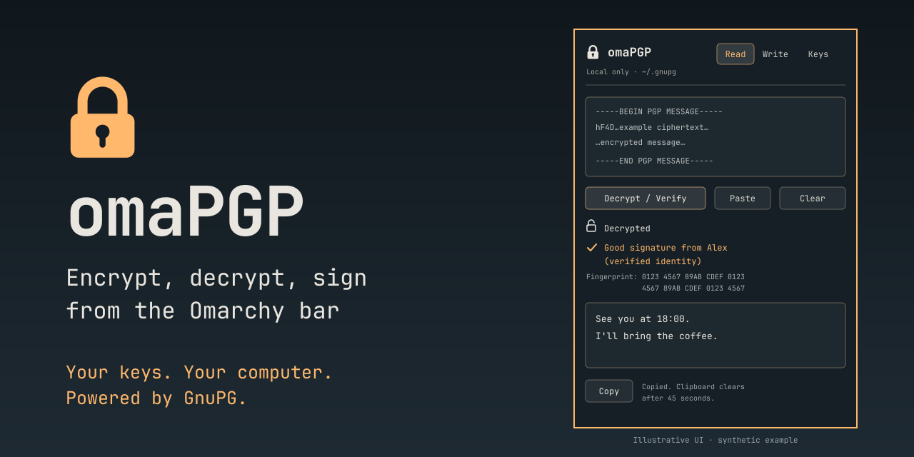

# omaPGP

A PGP panel for the [Omarchy](https://omarchy.org) bar. Read, write, encrypt,
decrypt, sign, and verify PGP text messages without leaving your desktop. It
uses your Omarchy theme and fonts and your local GnuPG keyring.

> Independent community plugin, not made or endorsed by Omarchy or GnuPG.
> Early-stage software: see [SECURITY.md](SECURITY.md) for its threat model and
> the manual checks still needed before the first release.

- **Read**: paste a PGP message or signed text to decrypt it and check who signed it.
- **Write**: encrypt to one or more people, optionally sign, or clearsign without encrypting.
- **Keys**: see your keyring, import keys by pasting them, copy your public key to share,
  and mark a key as verified after comparing fingerprints with its owner.



## Privacy

omaPGP is a thin interface over [GnuPG](https://gnupg.org); it does no
cryptography of its own.

- Message text goes through pipes to a disposable, resource-limited worker
  and `gpg`. The plugin does not put it on a command line, save it in message
  files, log it, or keep drafts/history. Imported keys are intentionally saved
  by GnuPG in the selected keyring.
- gpg runs with `--disable-dirmngr`, `--no-auto-key-retrieve`, and
  `--no-auto-key-import`, so it never contacts a keyserver and never imports
  keys you didn't paste in yourself. omaPGP itself makes no network requests.
- Closing cancels requests, destroys their output collectors, and clears the
  editors, undo history, and result references. This is best-effort cleanup,
  not guaranteed physical memory erasure.
- Messages are shown as plain text only; nothing is rendered as HTML and no
  remote content loads.
- Passphrases are handled by GnuPG's own agent and pinentry window. omaPGP never
  sees or stores them.
- Copying decrypted or signed-only text through its Copy button takes two clicks,
  is marked sensitive for clipboard managers, and is cleared after 45 seconds (configurable)
  if it is still there. Output views deliberately have no text-selection or
  built-in Copy action, so there is no alternate unguarded copy path. Sensitive
  hints are advisory: other applications and clipboard managers may ignore them.
- Encrypting to a key you haven't verified requires an explicit confirmation.

Limits worth knowing: Omarchy plugins run unsandboxed inside the shared shell
process, so omaPGP can't protect you from other plugins or a compromised user
account. Decrypted text is held in the shell's memory while the panel is open.
Qt/JavaScript may retain freed allocations, and the operating system may swap
shell memory or capture it in a core dump. The worker disables its own core
dumps; this does not change the shared shell's or the system's dump settings.
Copying a private key from another app before importing it may already have
placed it in clipboard history; omaPGP cannot remove another app's saved copies.

### Resource and configuration policy

- Input and clipboard pastes are limited to **64 KiB of UTF-8 text**. Output
  is limited to **256 KiB**, including decompressed plaintext and key listings.
  Larger messages or key bundles must be handled outside the panel.
- Each crypto worker has a **256 MiB address-space limit**, a **30-second CPU
  budget**, a **120-second wall-clock deadline**, and bounded diagnostic output.
  These limits are not a security sandbox or a limit on your shared GnuPG agent.
- `gpg.conf` is intentionally ignored. Configured extra recipients, group aliases,
  output destinations, default signing choices, and algorithm overrides do not
  silently apply to panel operations. Message output is forced to stdout and
  extra-recipient/group options are disabled explicitly.
- Your keyring and normal GnuPG agent are still used. `gpg-agent.conf`, pinentry,
  and hardware-token configuration remain under GnuPG's control. The agent is
  launched outside the disposable crypto worker's CPU/address-space budgets.
- Editing the draft, recipients, signing key, or encrypt-to-self option clears
  old output. Results from cancelled or superseded requests are ignored.

## Requirements

- Omarchy with the Quattro shell and Qt 6.9 or newer
- `gnupg`, `wl-clipboard`, and `python3` (Python standard library only)

## Install

Install from the repository's default branch (a development build until a
release is tagged):

```sh
omarchy plugin add https://github.com/yaeloss/omapgp.git --enable
```

Review the source before enabling: Omarchy plugins run unsandboxed inside the
shared shell. Installation needs no `sudo` and the plugin does not add a system
service or modify your Hyprland configuration. The optional keybinding below is
a manual change.

## Usage

Click the lock icon in the bar, or bind a key. Add this to
`~/.config/hypr/bindings.lua`:

```lua
o.bind("SUPER + ALT + P", "omaPGP", "omarchy-shell shell toggle io.github.yaeloss.omapgp '{}'")
```

| Key | Action |
| --- | --- |
| Ctrl+1 / Ctrl+2 / Ctrl+3 | Read / Write / Keys |
| Ctrl+Enter | Decrypt, encrypt, or import (depending on the tab) |
| Escape | Close and clear the panel |

### Getting your keys in

If you already use GnuPG, omaPGP sees your keys automatically. To bring a key
pair from elsewhere, paste its ASCII-armored private key block into
**Keys → Import keys**. To add a contact, paste their public key there.
Existing passphrase protection is preserved; importing an unprotected private
key does not add a passphrase.

### Verifying people

A key you've imported could belong to anyone. Before trusting it, compare its
fingerprint with the owner through a channel you trust, such as in person or by
phone, then press **Verify**. This certifies only the displayed identity, with
a local signature omitted by this plugin's public-key export. Other GnuPG
tools can explicitly export local signatures.

Verification belongs to a particular identity on a particular key. A newly
added identity is not automatically verified because another identity on that
key is certified. Signature results show the full key fingerprint and distinguish
a valid signature from a verified identity.

## Settings

Set these in the bar widget's settings, or in `~/.config/omarchy/shell.json`:

| Setting | Default | Meaning |
| --- | --- | --- |
| `gnupgHome` | (blank: `~/.gnupg`) | Use a separate keyring folder just for omaPGP |
| `copyClearSeconds` | `45` | Clear copied plaintext after this many seconds; `0` disables |

## Development

Portable tests (Linux, Node.js, Python 3, and GnuPG; CI uses Node 24):

```sh
bash tests/run-portable.sh
```

Full checks on an Omarchy installation:

```sh
bash tests/run-all.sh
```

The tests use throwaway keyrings in temporary folders and never touch
`~/.gnupg`. They cover parsing, per-identity trust, malicious configuration,
compressed-output limits, worker deadlines/cleanup, delayed callbacks, and
normal gpg encrypt/sign/decrypt/verify/import round trips. A protected test key
uses a test-only pinentry implementation, never a real password prompt.

Both QML harnesses use the offscreen backend. The UI harness instantiates the
actual plugin logic and controls with a stand-in for the Wayland-only popup
window; it does not inject desktop keystrokes or read the real clipboard.
Real popup focus, the interactive pinentry window, hardware tokens, and desktop
clipboard integration still warrant manual checks.

See [SECURITY-AUDIT.md](SECURITY-AUDIT.md) for the original findings and the
remediation record. Passing these tests is not a formal security certification.
GitHub Actions runs only the portable checks; it does not certify the desktop
integration. See [CONTRIBUTING.md](CONTRIBUTING.md) and [CHANGELOG.md](CHANGELOG.md).

## Remove

```sh
omarchy plugin remove io.github.yaeloss.omapgp
```

## License

MIT
